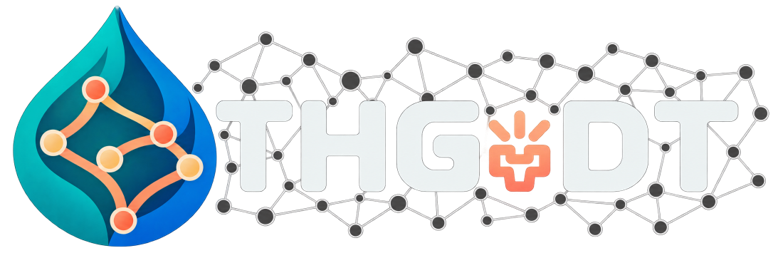

<p align="center">
  
</p>

<h1 align="center">THG-DT</h1>

<p align="center">
  <strong>A year-round digital twin for stormwater forecasting</strong>
</p>

<p align="center">
  Transformer · Heterogeneous graph learning · Stateful GRUs
</p>

<p align="center">
  <a href="https://thg-dt-thg-dt-2021327.2.rahtiapp.fi/">
    Explore the online digital twin
  </a>
</p>

---

## Overview

THG-DT is a machine-learning surrogate developed using
hydrological and hydraulic responses from a calibrated Storm
Water Management Model (SWMM).

The framework combines antecedent meteorological information,
drainage-network connectivity and persistent latent states.
It produces six predictions at 10-minute intervals over
a one-hour horizon.

### Predicted outputs

- Subcatchment snow storage and runoff volume.
- Junction, channel and outfall water depths.
- Junction flood-occurrence probabilities.

## How it works

1. **Remember the weather:** a Transformer summarizes
   antecedent meteorological conditions.
2. **Represent the network:** heterogeneous edge-aware graph
   learning captures drainage connectivity and object attributes.
3. **Update the system state:** stateful GRUs maintain evolving
   latent representations.
4. **Predict the response:** output heads generate hydrological
   and hydraulic forecasts.

The operational system uses FMI observations, radar-based
precipitation nowcasts and temperature forecasts. Its dashboard
is hosted on CSC Rahti.

**This repository contains the research model code.
The live dashboard is deployed as a separate application.**

## Code structure

| File | Purpose |
| --- | --- |
| `main.py` | Training entry point |
| `config.py` | Model settings, data paths and output locations |
| `data_loading.py` | Graph and scenario-data loading |
| `preprocessing.py` | Feature preparation and standardization |
| `model.py` | THG-DT neural architecture |
| `rollout.py` | Recurrent forecasting |
| `losses_metrics.py` | Loss functions and performance metrics |
| `training.py` | Training workflow |
| `evaluation.py` | Evaluation and prediction export |
| `reporting.py` | Training and evaluation summaries |
| `sanity.py` | Consistency checks |
| `utils.py` | Shared utilities |
| `legacy.py` | Compatibility helpers |

## Requirements

The code uses Python with:

- PyTorch and PyTorch Geometric.
- NumPy and pandas.
- s3fs for object-storage access.
- h5py, tqdm and a pandas-compatible Parquet engine.

Exact dependency versions should match the environment used
for the experiments. PyTorch installation depends on the
selected CPU or CUDA environment.

## Running the model

The training workflow requires:

- The static drainage graph and node/edge attribute tables.
- Meteorological scenario inputs.
- Corresponding SWMM-generated reference outputs.
- Access to the configured storage locations.

The supplied configuration refers to the original CSC Allas
storage locations. Obtain the required data and configure
storage access before execution.

Review `config.py`, then run:

```bash
python main.py
```

**This command starts the training pipeline. It does not
launch the online dashboard.**

Generated results are saved in `digital_twin_results/`.

## Data availability

The datasets used for model development are not included in
this repository. Please contact the authors regarding access
to the meteorological inputs, SWMM model files and
simulation-generated training data.

## Author and affiliation

**Farid Mousavi**  
Doctoral Researcher, University of Oulu

Developed within the **Digital Waters Flagship (DIWA)**.

## Research context

Model performance is evaluated against SWMM-generated
reference responses. Agreement with SWMM should be
distinguished from independent validation against field
measurements.

## Online dashboard

[Open the THG-DT dashboard](https://thg-dt-thg-dt-2021327.2.rahtiapp.fi/)
